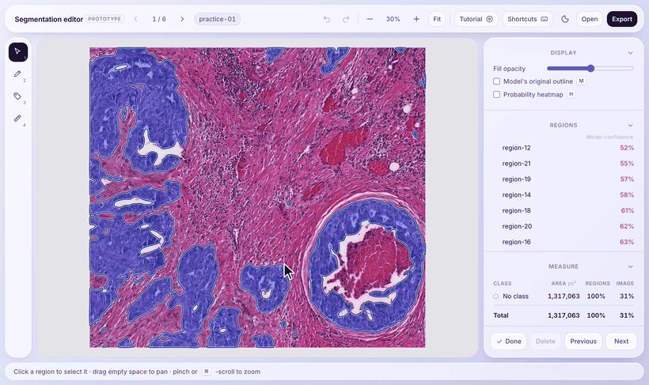

# Segmentation editor

**Correct a segmentation model's regions on tissue images in the browser, then export them to ImageJ, QuPath or plain masks.**



A segmentation model is usually about right. This editor is for the last part: an expert opens the model's
output, fixes the outlines that are off, draws what was missed, deletes what is wrong, and exports files that open
in the tools the lab already uses. The corrected masks can also go straight back into training.

> **Status: prototype.** Built and tested on public H&E images from Wikimedia Commons only. Not yet used by a
> person on real lab data, and not yet run on a real Windows machine.

**Try it now: https://segmentation-tool.fly.dev/editor** (a demo server: please do not upload confidential or patient images).

## What it does

| | |
|---|---|
| **Opens** | An image with the model's probability map or mask · a shaded image with its original · an ImageJ `.tif` with outlines · an image with an ImageJ RoiSet or QuPath GeoJSON · a whole folder or `.zip` of these |
| **Edits** | Drag a node or bend a line · draw a new region · extend or trim by redrawing a stretch of outline · split a region by drawing across it · merge, subtract, smooth, fill holes · grow or shrink from the model's own probabilities, or evenly by a set distance · add a band around a region · undo everything |
| **Labels** | Give each region a class (the list is set per library), mark it unsure, add a note · an Exclude class leaves artefacts out of the measurements |
| **Measures** | Area, perimeter, longest diameter and circularity of a region · area and share per class · a ruler · in µm once the pixel size is set · one CSV for the whole library |
| **Guides** | Regions are listed least-confident first, so the expert starts where the model was least sure · probability heatmap · the model's original outline as a dashed line |
| **Exports** | ImageJ `.tif` with editable regions · ImageJ RoiSet `.zip` · QuPath GeoJSON · mask PNG · shaded PNG, for one image or a whole library |
| **Teaches** | A first visit starts with a tour in which a pointer works the real editor step by step; the Tutorial button has a short clip for every tool |

## Try it on your computer

Needs Python 3.11 or newer (developed on 3.12).

```bash
git clone https://github.com/nikhil94571/segmentation-editor && cd segmentation-editor
python -m venv .venv && .venv/bin/pip install -r requirements.txt
.venv/bin/python serve.py          # then open http://127.0.0.1:8765/editor
```

On Windows: `py -m venv .venv`, then `.venv\Scripts\pip install -r requirements.txt` and
`.venv\Scripts\python serve.py`.

It opens with six practice images and the tour. To use your own, click **Open** and drop in a folder or a `.zip`.
Files are paired by name: `slide1_image.png` with `slide1_prob.tif` or `slide1_mask.png`.

## Using the editor

| Tool | What it does |
|---|---|
| **Edit** (`V`) | Drag a node to move it, drag the line to bend it, drag inside a region to move all of it. Double-click the line to add a node, a node to remove it. `Delete` removes the region. Clicking inside a hole selects just the hole. |
| **Draw** (`P`) | Press, drag, release. Finish where you started to close the shape. Drawn **inside** a region, the shape becomes a hole. A stroke that starts and ends **on an outline** replaces that stretch (extend or trim). A line drawn **right across** a region splits it in two. Drag back along your line to un-draw. |
| **Label** (`L`) | Click a region for a menu of classes beside it. Keys `1` to `9` set the class of the selected region in any tool; `U` marks it unsure. "Edit classes" changes the list for the library. |
| **Ruler** (`R`) | Drag to measure a distance. |
| **Reshape bar** | Appears under the image when a region is selected with the Edit tool: Merge and Subtract (then click the other region), Fill holes, Smooth, and Grow, Shrink or Band by a typed distance. |
| **Measure** | A collapsible panel: the pixel size, the selected region's measurements, and totals per class. |
| **Grow / shrink** | A slider that re-cuts the selected region from the model's probability map, so the edge moves most where the model was unsure. Without a probability map it moves the edge evenly. |
| **Region list** | Least-confident first; `N` steps through it. |
| **Display** | Fill opacity, the model's original outline (`M`), probability heatmap (`H`). Hold `X` to hide the regions and see the bare tissue. |
| **Images** | `[` and `]` go to the previous and next image; `D` marks an image done. Work is saved as you go. |

Each region is a few nodes joined by curves (cubic Béziers fitted to the model's outline), so an outline is
adjusted by moving a handful of points and not hundreds.

## The command-line converter

The same conversion without the editor: model output in, ImageJ and QuPath files out.

```bash
# The model's own output: original image + probability map or mask
.venv/bin/python highlight2imagej.py out/ --image tissue.png --prob prob.tif      # [--threshold 0.5]
.venv/bin/python highlight2imagej.py out/ --image tissue.png --mask mask.png      # PNG/TIFF/NPY, binary or labels

# Only a picture of the shaded result
.venv/bin/python highlight2imagej.py out/ --overlay shaded.png --image tissue.png   # any shading colour
.venv/bin/python highlight2imagej.py out/ --overlay shaded.png                      # blue shading only

# Back from an expert's edited file to a mask (for retraining or measurement)
.venv/bin/python imagej2mask.py out/x_ImageJ.tif corrected_mask.png
```

Each run writes `<name>_ImageJ.tif` (the clean tissue image with every region as an editable ImageJ shape filled
translucent blue, so edits move the blue), plus `_RoiSet.zip`, `_QuPath.geojson`, `_tissue.png`, `_mask.png` and
`_regions.csv` (with the mean model probability per region when a probability map was given).

In ImageJ: Image › Overlay › **To** ROI Manager → click a region → drag its handles → Update →
Image › Overlay › **From** ROI Manager → Save. A region without holes is a plain polygon with handles. A region
with holes is ImageJ's composite shape: one entry, the holes really empty, so it measures correctly; ImageJ gives
those no handles, and they are adjusted by Shift-drawing to add, Alt-drawing to cut, or the selection brush.
`--split-holes` on the command line writes each hole as its own polygon named
`<region>-hole-K` instead, so everything has handles; `imagej2mask.py` reads both forms.

## Hosting it

`HOSTED=1 python serve.py` runs the editor for people who only have a link:

- every browser gets its own private workspace (a cookie), so visitors never see each other's edits or uploads;
- Export downloads a `.zip` instead of writing to a folder on the server;
- workspaces untouched for 14 days are deleted when the server starts. There are no accounts and no database.

**It is a demo server, not a secure one.** There is no login and anyone with the link can upload images. The
Open dialog says so and asks people not to upload confidential or patient images.

### Hugging Face Spaces

```bash
pip install huggingface_hub && hf auth login       # a token with write access
python deploy/space.py                             # builds scratch/space/: exactly what would be uploaded
python deploy/space.py <user>/segmentation-editor  # creates the Space and uploads it
```

The Space builds the `Dockerfile` and serves the editor at `https://<user>-segmentation-editor.hf.space`. Send
that link, not the `huggingface.co/spaces/…` page. Docker Spaces need a paid (PRO) Hugging Face account; this
route was prepared but has not been run.

### Fly.io, or anything that runs a Dockerfile

```bash
fly auth login
fly apps create <app name>               # and put the same name in fly.toml
fly deploy --ha=false                    # one machine; https://<app name>.fly.dev
```

The container listens on `$PORT` (8080) and keeps its data in `$DATA_DIR` (`/data`), which is lost on a redeploy
unless a disk is attached there. Allow about 1 GB of memory.

The live demo runs this way on Fly.io: one shared-CPU machine with 1 GB of memory in Sydney, suspended when
nobody is using it. Measured on 15 Nov 2026, it wakes in under a second.

## How well it works

Measured on 11 Nov 2026, on regions read back from the saved `.tif`:

| Check | Result |
|---|---|
| Model output → regions, against the model's mask (IoU) | mean **0.984**, lowest 0.954 |
| Shaded picture → regions, against the model's mask (IoU) | mean **0.975**, lowest 0.870 (a bluish-stained slide) |
| Exact mode (`--tolerance 0`), 507 masks | **507 of 507 pixel-exact** |
| ImageJ `.tif`, RoiSet and QuPath GeoJSON | identical masks |
| Shading of any colour, with the original image (`tests_overlay.py`: ten colours, three opacities) | mean IoU **0.985** |
| Editor self-test (`viewer/editor/selftest.js`, 44 results through the real page) | all pass, 16 Nov 2026 |

Known limits:

- **A shaded picture without its original** is only read if the shading is blue, and on a bluish-stained slide a
  cluster of bluish nuclei touching the shading can be included. With the original image, or with the model's own
  output, neither applies.
- **Still to confirm by hand:** the full round trip in Fiji (edit, save, `imagej2mask.py`) and QuPath's import of
  the GeoJSON.
- **Classes are not exported yet.** They are saved with the regions and appear in the measurements CSV, but the
  ImageJ, QuPath and mask exports do not carry them.
- **Windows and Linux** use the system folder chooser and Ctrl shortcuts; checked in a browser pretending to be
  Windows only.

<details>
<summary><b>How the conversion works</b></summary>

1. **Mask.** From the model's output: threshold the probability map, or read the mask. From a shaded picture with
   its original: the shading is wherever the two pictures differ, so its colour does not matter
   (`overlay_detect.py`). From a shaded picture alone (blue only): a pixel is a candidate if its hue is blue
   (190–262°), and a candidate region is kept only if it contains a solid core where smoothed blue-minus-red is
   above 85. Blending towards blue raises that everywhere the shading covers, while stain raises it only on
   scattered nuclei. The blue is then un-blended to recover a clean base image.
2. **Tidy.** Drop specks under `--min-area` (200 px); fill holes under `--min-hole` (200 px).
3. **Outline.** Trace, simplify (`--tolerance 2` px, Douglas-Peucker) and write editable ImageJ polygons with a
   blue fill.

A colour-free detector for shaded pictures without the original (the overlay's edge as one consistent colour
step) was tried on 11–13 Nov 2026 and dropped: it worked on crisp synthetic overlays, but not on compressed or
resized pictures, and needed thresholds tuned to these images.

</details>

<details>
<summary><b>Test data</b></summary>

- `prepare_tissue.py`: 11 breast H&E images from Wikimedia Commons, cropped to 2048 × 2048 (two exist only at
  1532 × 1532 and are not upscaled).
- `make_cases.py`, per image: `expert.png` (ground truth); `prob.tif`, a float32 probability map shaped like a
  segmentation head's output (soft edges, about 0.95 inside, a lower-confidence false positive, sub-threshold
  "maybe" areas, noise); `mask.png` (probability ≥ 0.5); `overlay.png` (the mask drawn in blue).
  **These are simulated model outputs, not the output of a trained network.** The simulated model is
  deliberately imperfect: Dice 0.83 against the expert mask.
- `data/practice/` holds six of these probability maps; with their images in `data/tissue_2k/` they are the
  built-in "Practice images" library.
- `run_all.py` runs every case through both routes; `serve.py` then shows them side by side at
  http://127.0.0.1:8765 with approve/decline buttons (`qa/decisions.json`).

</details>

<details>
<summary><b>What is where</b></summary>

| Path | What |
|---|---|
| `highlight2imagej.py`, `imagej2mask.py`, `overlay_detect.py` | The converter, the way back to a mask, shading detection |
| `serve.py`, `editor_backend.py` | The server: import, libraries, grow/shrink re-cut, export, hosted workspaces |
| `viewer/editor.html`, `viewer/editor/app.js`, `geom.js` | The editor page, the canvas app, the geometry (no DOM) |
| `viewer/editor/tour.js`, `tutorial.js`, `tutorial/` | The first-visit tour, the Tutorial panel, its clips |
| `tutorial/` | The recorder that makes the clips from the real editor (`tutorial/README.md`) |
| `deploy/`, `Dockerfile`, `fly.toml` | Hosting |
| `tests_roundtrip.py`, `tests_overlay.py`, `verify_roiset.py` | Checks |

</details>

## Data and licences

`data/tissue_2k/` holds 11 H&E images from Wikimedia Commons, cropped to squares. Authors, source pages and
licences (CC0, CC BY-SA 3.0, CC BY-SA 4.0) are listed in `data/tissue_2k/SOURCES.json`; the crops are shared under
the same licences. Everything else under `data/`, `out/`, `sessions/` and `libraries/` is generated locally and is
not in the repository.
