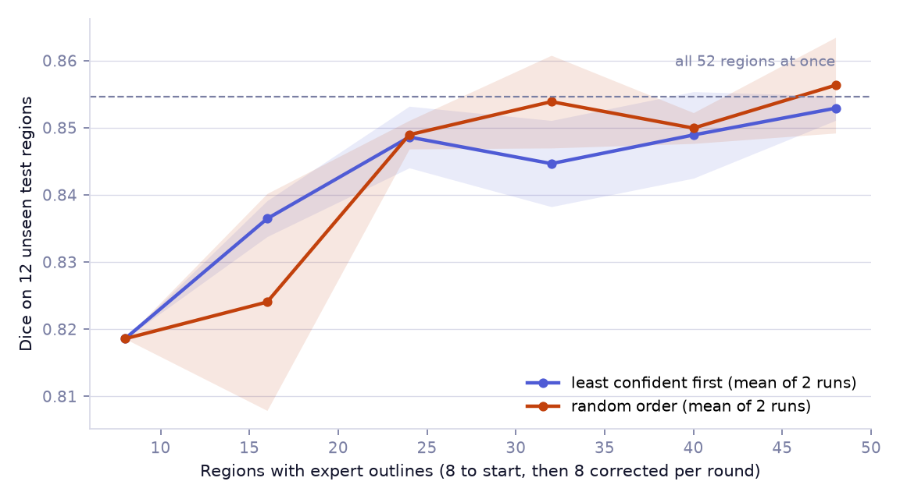
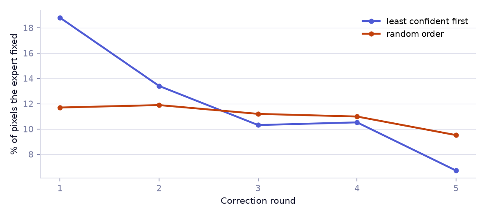

# Retraining from corrections

Does correcting the model's output, and training on the corrections, make the model better? This page is generated by `ml/report.py` from `results.json`, which `ml/loop.py` writes.

**Correcting 40 regions raised Dice on 12 unseen test regions from 0.819 to 0.853 (least confident first) and 0.856 (random order).** A model trained on all of them at once, from scratch, reaches 0.855.

Choosing the least confident regions first was ahead after round 1 (by up to 0.012), but over all rounds the two ways of choosing are within the run-to-run noise below, so this run does not show that the order matters much at this scale.

## What was done

- **Data:** 64 regions of BCSS (breast cancer, TCGA; CC0), each from a different patient, at 1 µm per pixel. Task: tumour (BCSS tumour, DCIS and angioinvasion) against all other tissue.
- **Split, fixed:** 12 test regions the model never trains on; 8 to train the first model; 44 in a pool, of which the loop uses 40.
- **Model:** U-Net with an ImageNet-pretrained ResNet-34 encoder, 600 training steps for the first model, then 300 fine-tuning steps per round.
- **Loop:** each round, 8 pool regions are corrected and the model is fine-tuned on everything corrected so far. **The expert's corrections are stood in for by the BCSS expert outlines**; nobody corrected these by hand. `ml/retrain.py` does the same step from real corrections saved in the editor.
- **Which regions get corrected:** least confident first (as the editor lists them) against random choice. Each was run with 2 seeds; the seeds vary the fine-tuning (and the random choice), not the first model, which all runs share.

## Results

| | Regions with expert outlines | Test Dice |
|---|---|---|
| First model | 8 | **0.819** |
| least confident first, round 1 | 16 | 0.836 |
| least confident first, round 2 | 24 | 0.849 |
| least confident first, round 3 | 32 | 0.845 |
| least confident first, round 4 | 40 | 0.849 |
| least confident first, round 5 | 48 | 0.853 |
| random, round 1 | 16 | 0.824 |
| random, round 2 | 24 | 0.849 |
| random, round 3 | 32 | 0.854 |
| random, round 4 | 40 | 0.850 |
| random, round 5 | 48 | 0.856 |
| All regions at once, from scratch (reference) | 52 | 0.855 |

The second chart is the expert's workload: the share of the chosen regions' pixels the model had wrong before they were corrected. Each round looks at different regions, and least-confident-first picks the hardest on purpose, so this is the work asked of the expert, not a fixed before-and-after test.

## Limits

- Simulated expert: the corrections are BCSS's own outlines, which were made by pathologists and trainees and reviewed, not corrections made in this editor.
- Small test set (12 regions) and one task (tumour or not). Between seeds the test Dice differs by up to 0.032 in a round, and from one round to the next the mean moves by up to 0.025; differences smaller than that are noise.
- One dataset (BCSS, TCGA breast cancer slides), one stain normalisation, one magnification.
